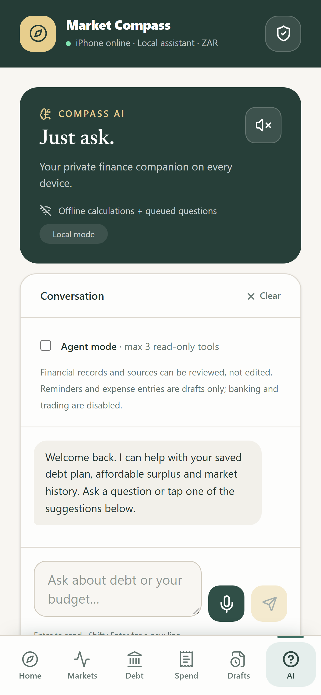

# Market Compass — AI mobile layout & read-only bank onboarding (23 November 2026)

## Implemented in shared frontend

- Compact assistant hero, status badge wrapping, smaller message bubbles and clearer line-height.
- Chat log now collapses when cleared, rather than reserving a large empty panel.
- iPhone composer retains at least 44px square mic/send controls, a useful text input width, a 16px input font to avoid Safari focus zoom, and visible key instructions.
- **Enter sends a question once**; Shift+Enter allows an actual newline; IME composition/229 key handling must not send. Browser regression checks use a real 390×844 Chromium viewport, but physical Safari acceptance is still required.
- Compact Vault panel title/refresh buttons wrap without squeezing.
- The assistant's financial sources include an honest **Bank connections: Not connected** section with a working shortcut to statement import, instead of a fake bank-login button.

## Bank integration: verified position, not yet live

The private financial inventory reports `bankOAuthConnected=false`, `liveBankFeeds=0`, `bankVerifiedCurrentBalance=false`. **No customer bank account is connected.** Manual account data, bank statement uploads and inferred financial summaries remain unverified and owner-controlled.

Current official candidate pathways (eligibility is not authorization):
- **Investec Developer / Third Parties** — https://developer.investec.com/third-parties . Published three-legged OAuth consent options for approved third parties and account-data use cases. Choose GET/transaction read operations only; do not request payment execution scopes.
- **Nedbank Accounts API** — https://personal.nedbank.co.za/content/nedbank/za/en/api-marketplace/find-the-right-api/accounts-api.html . Advertises account details, balances and transaction history; bank partner/API subscription, consent and exact access entitlement must be confirmed.
- FNB's enterprise transaction API and Standard Bank's approved accounting feeds may serve eligible use cases, but must not be described as public, unrestricted retail OAuth. An aggregator might be available, but credential-sharing/scraping cannot be silently substituted for verified bank-hosted consent.

## Incremental implementation and gates

1. Confirm eligible banking provider, official developer contract, approved read-only product scope and test/sandbox tenant. No passwords, OTPs, API tokens or bank data belong in Git, AI prompts or chat logs.
2. On HYPRBOX's **authenticated private gateway**, separately add allowlisted OAuth callback, CSRF state, PKCE as applicable, issuer/audience, expiration and redirect checks, replay protection and structured disconnect/revocation. Do not expose Ollama, the bridge, or gateway secrets.
3. Keep bank tokens/refresh tokens on HYPRBOX protected by DPAPI and file ACLs; never in a public PWA bundle or either browser vault. Mask all source account identifiers before UI.
4. Convert consented account/transaction data through `financialSourceNormalizer.ts`. The private variant now matches the public normalizer for direction: positive absolute debits are marked **outgoing** only when explicitly mapped by the adapter; missing direction is **unclassified**, never guessed from sign. Invalid dates, other currency, subcent values and account-number labels are rejected.
5. Preserve posted/pending flags, account separation, page cursors, provider transaction IDs and observed timestamps on the server. Do not treat a matchHint as a transaction identity: identical fees can be legitimate separate transactions.
6. Normalize into **pending-owner-review** candidates; do not silently modify encrypted Spend, debts or balances, and do not add payment/write endpoints. Report stale/expired/revoked/unknown feeds honestly.
7. Mock provider approval, declined consent, token expiry/revocation, paging, duplicate fees, positive debits and transaction precision; then physical iPhone tests of both PWA origins, including encrypted Files backup and safe restore.

**This change does not create a live bank authorization.** An eligible provider sandbox and explicit user consent are required before wiring any real bank data.

## Synthetic iPhone visual preview

The screenshot below was captured in an isolated, **fabricated-data** Chromium vault, at 390 × 844 CSS pixels with 3× DPR. No real account, chat history, passwords or private gateway tokens were used. The physical Safari keyboard interaction still requires owner confirmation.

