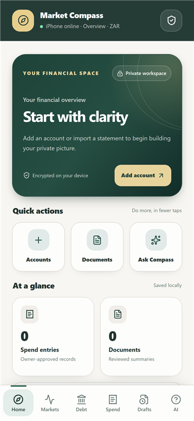

# Market Compass — Bootstrap-assisted mobile banking UX

Updated: 23 November 2026. Development branch only: `feature/bootstrap-mobile-app-shell-20261123`.

## Design decision

Market Compass already has Tailwind v4, a custom offline PWA shell, Lucide icons, and financial form components. Loading the **full Bootstrap CSS and JavaScript** would conflict with the existing forms, input sizing, navigation and iPhone safe-area rules. Instead, this change vendors **Bootstrap 5.3.9 grid CSS only** (MIT licence retained) under `artifacts/market-compass/src/vendor/bootstrap/`. It is imported before Tailwind's local `index.css`. There is no CDN, bootstrap.js dependency, dynamic package download at runtime, or dependency-lockfile change.

Actual Bootstrap `.row`, `.col-4`, `.col-6`, `.col-12` and `.g-*` classes now power responsive quick actions, dashboard figures and expanded account details. Tailwind remains responsible for components and the CSS is deliberately scoped with `mc-*` classes where applicable. The minified grid vendor file is approximately 52 KB (before gzip), while the compiled CSS remains bundled offline with the PWA.

## Interface improvements

- **Native finance overview first:** compact deep-green gradient wallet-style card with an owner-entered debt summary or a meaningful empty state. No inferred bank balances or imaginary available funds. The collapsed Vault & Settings panel moves below the route content, still reachable from the existing shield button in the sticky header.
- **Quick actions:** direct Accounts, Documents and Ask Compass shortcuts, with large touch targets.
- **At a glance:** owner-approved Spend row count, reviewed document summary count and pending draft count. No misleading totals built from unverified, mixed-currency or overlapping sources.
- **Per-account banking rows:** one collapsible, vertical row per manually entered debt account. Readable entered balance, APR, monthly minimum and clear 'Not bank connected' provenance. Account names pass through the existing local PII masking function before display to avoid exposing typed account numbers in the overview. Accounts remain editable through Debt Plan; nothing is fetched from a bank.
- **Market snapshot:** clearly marked historical, with a source date and approximate conversion disclaimer; not a live holding.
- **Navigation and forms:** rounded bottom tabs with a visible active indicator; the six routes and iOS safe-area painting, no-blur header, offline PWA and protected Ollama gateway remain unchanged. Shared generic panels have softer, more consistent corners on Debt, Spend and Markets.
- **Privacy and offline:** one local CSS asset, no external script, analytics, tracking, network grant, or storage schema change. Bootstrap is not used to handle transaction input or authentication.

## Roadmap alignment

The user requested the familiar 22seven/Vault22 account-by-account banking layout, smoother curved navigation tabs, concise first-screen summaries, accessible document entry, and clearer financial source confidence. These improvements are surfaced now in the existing shared PWA React code. The original and private iPhone PWAs continue to share functional code and security constraints, with separate origin vaults.

Still future work: official read-only bank aggregation/OAuth, explicit email consent, scanned-document OCR, cross-source historical reconciliation, unified live source-health/freshness, native closed-app document scanning, and physical iPhone Safari Share-to-Files/vault migration acceptance. This visual release does **not** claim any of those are operational.

## Tests and release gate

- `tests/bootstrap-app-shell.test.mjs` validates offline Bootstrap grid packaging, MIT licence, account presentation, source disclaimers, safe areas and route preservation.
- `scripts/browser-release-gate.mjs` now forces a **390 x 844 mobile viewport**, checks the actual computed Bootstrap 3-column grid, active six-tab shell, quick actions and privacy copy, then creates a fabricated account and expands it to verify balance/rate provenance. Its existing synthetic CSV/PDF password, duplicate, vault lock/unlock and two-origin restore checks are still required.
- Test screenshots are optional and **synthetic only** via `MC_TEST_SCREENSHOT`. The test removes its disposable browser profile and never visits real PWA origins or accesses owner files.

No live site was deployed in this branch. Review with a backup-first physical iPhone test before publishing to either app origin.

## Mobile design preview

The image below is from a freshly created, isolated browser vault containing **no real financial information**. It demonstrates the new first-screen layout at a 390 × 844 CSS-pixel viewport.

