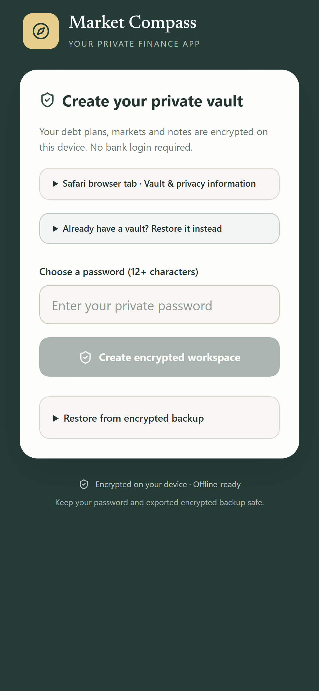

# Market Compass — compact vault entry and safe UI parity rollout

Updated: 23 November 2026.

## Screenshot feedback

The iPhone screenshot of the authenticated ngrok PWA confirmed its Bootstrap banking dashboard now works, but the locked vault screen occupied most of the phone's height. Both PWA code variants now share the same **compact** `VaultScreen` implementation.

At 390×844 CSS pixels on a synthetic Edge mobile device, the first-run vault card measures ~342×476 CSS pixels. The locked screen is shorter because the first-run recovery warning is absent. Improvements include a 390px maximum wrapper, smaller logo and heading, compact paddings, a collapsible privacy/session explanation, and a collapsible existing-vault import warning. The label and input remain separate; the password input uses **16px** to avoid iOS Safari focus zoom and has a minimum 48px touch height. The button and restore flow remain in the app; there are no password, vault, encryption, endpoint or IndexedDB schema changes.

New tests: `tests/compact-vault-login.test.mjs`, plus true-mobile browser dimensions, the collapsed privacy details, the presence of encrypted restore, and a complete synthetic vault creation, import, lock, unlock and cross-origin restoration in the private branch. The public branch's browser gate checks the same mobile dimensions before verifying account summaries and privacy-masked labels.

## Public PWA source-core check (release gate scoping)

The original GitHub Pages `main` branch has independently gained source-normalizer, bank-statement and payslip functionality that is absent from the older `feature/ios-safari-launch-2026-11-26` staging branch. Attempting to copy these evolving parsers into the older staging branch failed baseline compatibility tests due to missing modules and changed interpretation. That experimental work was **reverted without a commit or deployment**. The finance source core remains unchanged in both public and private UI candidates.

The existing `validate-owner-document-parity.yml` job previously required all eight finance core files to be identical across unrelated branches, blocking even UI-only releases because of **pre-existing** drift. The updated guard:
1. Requires every one of the eight finance core blobs in the PR result to be identical to the target branch's existing blob, **or** to the protected staging branch's blob if modified.
2. Rejects any modified finance-core file that differs from the protected staging reference.
3. Emits a visible GitHub Actions warning for each unchanged source file that still differs between baseline branches.
4. Continues running all bank parser, payslip, PDF, reconciler, ledger and financial readiness tests and the production build; it does not claim the pre-existing cross-branch data semantics are identical.

Thus UI-only PRs can be released without downgrading tested public parser behavior, but no unaudited finance-core change is allowed. Full feature parity remains an outstanding roadmap integration, not a claim of this visual release.

## Data and release acceptance

The owner confirmed both iPhone PWAs successfully export encrypted `.json` backups into the device's Files app. That verifies the native export step, **not** successful decryption/restore; a synthetic browser restore was tested separately. Both live PWA origins must retain their independent IndexedDB vaults and existing URLs. Do not clear site data, uninstall the Home Screen app or restore one origin's backup into the other without explicitly choosing which data to keep.

The public PWA follows GitHub Pages `pages.yml` on `main`; the private ngrok PWA uses a separate static directory behind authenticated private desktop gateway with mandatory Ollama loopback. Use protected `MC_PWA_OUT_DIR` staging for private build, then preserve previous static directory on atomic promotion and run `tools/check-market-compass-private-ui.ps1` after promotion.

## Synthetic visual preview

### Hash-pinned existing parser drift (not semantic equivalence)

For the public visual-only release, the parity workflow now records the **exact Git blob SHA-1 pairs** for the seven pre-existing source differences between current public `main` and `feature/ios-safari-launch-2026-11-26`. A changed hash on either side fails CI, as does any new core-file change unless it matches the protected staging source. The eighth core file (`vehicleFinance.ts`) already matches. This narrowly allows an unchanged visual-only release while retaining a fail-closed check for any newly introduced parser drift. It is **not a waiver of future financial-core reconciliation** and does not claim equivalent classification behaviour. Automated parsing tests remain mandatory.
