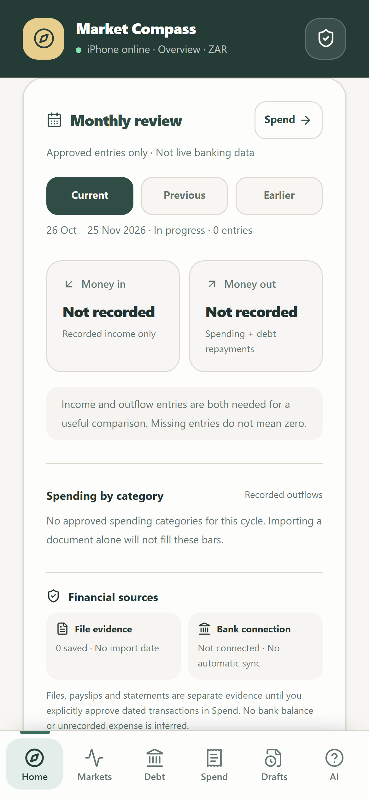

# Market Compass — Financial Pulse UX and competitor references

Date: 23 November 2026. Scope: shared PWA frontend / local encrypted finance evidence, **not bank aggregation**.

## Product/design references

This is an evaluation of **patterns**, not a claim that Market Compass uses another app's proprietary code or that competing apps' South African bank coverage applies to us.

| Reference | Relevant interaction | Applied in Market Compass | Deferred |
| --- | --- | --- | --- |
| Old Mutual 22seven (historical screenshots from 2020–21) — https://www.itweb.co.za/article/old-mutuals-22seven-refocuses-strategy-with-new-business-units/RgeVDqPYdnWvKJN3 | Account-level balances, budget category progress, helpful clear tab navigation | Existing expandable manual accounts, explicit source disclaimer, simple category bars | Account linking is **not** available yet |
| Monarch Money — https://help.monarch.com/hc/en-us/articles/360048393272-Getting-Started-with-Monarch and https://help.monarch.com/hc/en-us/articles/4402543752468-Monthly-Progress-Report | Monthly spending/cash-flow check-in and transaction review | Owner-approved Money in/out, recent-entry drawer, period tabs | Bank sync, household sharing, automatic review |
| YNAB — https://support.ynab.com/en_us/getting-started-transactions-and-categories-SJejV3szx | Category review, manual/file import before budgeting and matching | Deterministic category grouping of approved Spend entries only | Automatic matching, category suggestions and split payments |
| PocketSmith — https://pocketsmith.helpkit.so/mobile--desktop-apps/6a6X8SseDAGPHm5D1QSQBH/mobile-overview-of-pocketsmith-mobile-apps/6FxpuR5tSasvyFExz2ZGGi and https://www.pocketsmith.com/features/budgets-and-planning/ | Source feed status, budget calendar and financial forecasts | File last-import date and explicit **Bank connection: Not connected** label | Projected future balances until scheduled transaction/recurrence evidence exists |

The visual design retains Market Compass's existing deep-green + parchment/gold palette, Bootstrap grid, compact text and Safari safe areas. It is not an imitation of another app's branded interface.

## Implemented: Financial Pulse, read-only

- `components/FinancialPulse.tsx` is a shared responsive card shown on **mobile Home below At a glance**, and in the desktop overview.
- Explicit Current / Previous / Earlier **26th-to-25th salary-cycle** selectors. Selecting another cycle changes local view state only; no new stored settings or remote API calls.
- Money in (confirmed in the owner's **saved Spend ledger**) and Money out (approved expenses + repayments). Transfers stay separate; missing entries display **Not recorded**, never assume zero or available cash. An `income - outflow` *recorded difference* appears only when **both** sides have records, and is explicitly **not** a bank balance.
- Top category progress bars represent manually recorded outflows; monthly spending limit is optional and owner-entered, and progress is labelled **recorded against limit**, not total consumption.
- Recent approved rows are collapsed by default and have PII-masked descriptions.
- Source panel displays local saved document count, last valid import timestamp, and **Not connected · No automatic sync** for banks. Payslips, bank statement excerpts and receipts remain separate **evidence** until owner explicitly approves dated Spend rows.
- Cross-currency entries are excluded from ZAR figures and shown as an excluded count rather than being silently converted or added.
- Validates ledger records before analytics so malformed dates/amounts cannot be silently added. No vault format change, permissions expansion, sync, bank login or automatic ledger writes.

## Verified test cases

- Salary boundary 25th/26th and two prior cycles.
- Approved salary, expenses, loan repayment and transfers; positive amount vs financial direction; prior/next period excluded.
- USD entry excluded from ZAR, no inferred FX conversion.
- Payslip evidence does not fabricate logged income; missing income/outflow produces **Not recorded**, not a false zero or negative cash balance.
- Malformed dated entries and invalid owner budget don't pollute totals.
- Spending-limit percentage can exceed 100% without pretending remaining cash is known.
- Both PWA TypeScript, Node test suites, production subpath builds, offline workers and synthetic 390×844 Chromium browser layout/period-selection/recovery smoke tests run locally. A real physical iPhone UI and vault restore check remains separate.

## Roadmap after this change (prioritized)

1. **Unified source freshness**: distinguish private owner-entered values, reviewed document excerpts, agent-visible HYPRBOX metadata and any future provider-signed account snapshots; show record dates, status and missing/unknown coverage without merging unlike evidence.
2. **Cross-document reconciliation**: deterministic normalized transaction identities where provider IDs exist, source/time/amount match suggestions where not; review duplicate-looking fees and transfer reversals explicitly. No silent posting.
3. **Recurring bill planner**: only after recurring patterns are approved by owner; do not present forecasts from incomplete statement history as verified balances. Later consider PocketSmith-style bill calendar.
4. **Direct read-only bank pilot**: identify a single eligible South African institution, acquire approved OAuth sandbox and account-data scope, register a strict authenticated HYPRBOX callback with state/PKCE, token expiry/revocation and DPAPI custody. No client-side bank passwords, no payment scopes or raw tokens in Ollama. User consent and sandbox entitlement required.
5. **High-volume import/OCR and cross-origin vault migration**: per-page streaming, review queues, encrypted snapshot backup and non-destructive restore on Safari, independent origin preservation; do not assume arbitrary background filesystem or mailbox scanning is available to Safari.

## Release discipline

These code changes are visual/read-only and can be promoted independently to the existing owner-protected ngrok PWA and public GitHub Pages PWA **only after** CI, static subpath/PDF-worker verification and retained static rollback. The owner confirmed encrypted JSON Files exports in both origins; this does not establish a successful real-device restore. Never clear Safari website data or use private owner vaults for screenshot fixtures.

## Synthetic mobile preview

This is a 390×844 CSS-pixel synthetic browser profile (DPR 3), not a production account or private iPhone screenshot. It shows the **Current** salary cycle with no fabricated income or expenses; missing figures correctly remain *Not recorded*.

